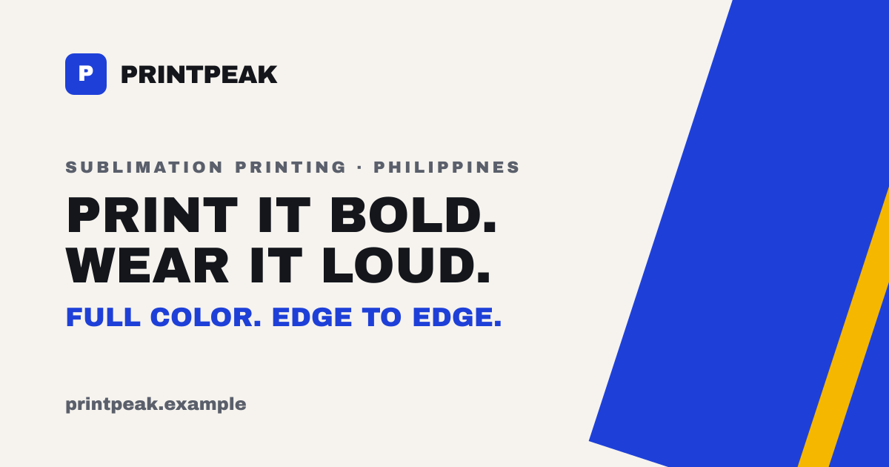

# PrintPeak Sublimation — sample website



A ready-to-customize, one-page website for a **full sublimation printing business**
(jerseys, cycling and esports wear, hoodies, mugs, lanyards, banners).
Built with Next.js, TypeScript and plain CSS. No database, no backend: every page is static.

> **This is a demo.** "PrintPeak Sublimation", the logo, contact details and size charts are
> placeholders. The photos are free stock images from Unsplash. Swap in your own before going live.

## What's on the page

| # | Section | What it does |
|---|---|---|
| – | Hero | Headline, short intro, Get a Quote button, photo |
| – | Marquee | Scrolling strip of short selling points |
| 01 | Products | Six product cards with photos |
| 02 | Size guide | Pick a garment and cut, see chest and length, switch inches/cm |
| 03 | Why us | What sublimation does, in plain words |
| 04 | Process | Five steps from idea to delivery |
| 05 | Contact | Email, phone, location and a spot for your quote form |

Also included: sticky contact bar on phones, back-to-top button, custom 404 page,
scroll animations (switched off for people who prefer reduced motion).

## Built in

- **SEO:** titles, descriptions, canonical URLs, `sitemap.xml`, `robots.txt`, web manifest
- **Social sharing:** Open Graph and X (Twitter) cards with generated 1200×630 images
- **Structured data:** Organization, WebSite and LocalBusiness JSON-LD
- **Accessibility:** skip link, keyboard-friendly menu, visible focus ring, labelled controls, AA contrast
- **Performance:** static pages, `next/image`, self-hosted fonts, no animation libraries
- **Analytics:** Vercel Analytics and Speed Insights (start reporting once deployed on Vercel)

## Quick start

Needs Node.js 20.9 or newer.

```bash
npm install
npm run dev        # http://localhost:3000
```

| Command | What it does |
|---|---|
| `npm run dev` | Start the local dev server |
| `npm run build` | Build the production site |
| `npm run start` | Serve the production build |
| `npm run lint` | Check the code |
| `npm run todos` | List every placeholder still to replace |
| `npm run check:assets` | Check image sizes and ratios |

## Make it yours

All words and business details live in `src/content/`. Components never hold copy.

| To change | Edit |
|---|---|
| Business name, email, phone, address, socials, domain | `src/content/site.ts` |
| Hero, products, why-us, process, contact wording | `src/content/home.ts` |
| Size charts | `src/content/sizes.ts` |
| Menu, footer links, sitemap | `src/content/navigation.ts` |
| Section order (or hide one) | `src/config/sections.ts` |
| Turn modules on/off, pick a theme preset | `src/config/features.ts` |
| Colors, spacing, type sizes | `src/styles/tokens.css` |
| Fonts | `src/lib/fonts.ts` |
| Logo | `src/components/LogoMark.tsx` and `public/images/logo/` |
| Photos | `public/images/` (sizes in `public/images/README.md`) |
| Quote form (Tally, Typeform, Google Forms…) | `src/components/FormEmbed.tsx` |

**Themes:** four presets ship in `tokens.css`: `peak` (royal blue, default), `crimson`, `lime` (dark)
and `mono`. Change `theme` in `src/config/features.ts` to switch.

## Project structure

```
src/
  app/          layout, home page, 404, sitemap, robots, OG images
  components/   layout/ (header, footer, section), sections/, ui/ (button, icon, marquee)
  config/       sections.ts (home order), features.ts (switches)
  content/      all copy and business facts
  lib/          fonts, SEO, JSON-LD, OG image renderer
  styles/       tokens.css (the theme)
public/images/  logo, hero and product photos
scripts/        todos and asset checks
```

## Deploy

1. Import the repo into [Vercel](https://vercel.com/new) (framework: Next.js, no environment variables needed).
2. Add your domain and update `url` in `src/content/site.ts`.
3. Turn on **Web Analytics** and **Speed Insights** in the Vercel project.
4. Submit `https://your-domain/sitemap.xml` in Google Search Console.
5. Test link previews with the Facebook Sharing Debugger and LinkedIn Post Inspector.

## Credits

- Photos: [Unsplash](https://unsplash.com), under the [Unsplash License](https://unsplash.com/license). See `public/images/CREDITS.md`.
- Fonts: Archivo Black, Inter and JetBrains Mono (SIL Open Font License), via Google Fonts.
- Layout inspired by the look of a local Philippine print shop site. No code, text or images were copied.

## License

The code is released under the MIT License. See [LICENSE](LICENSE). Photos and fonts keep their own licenses.
